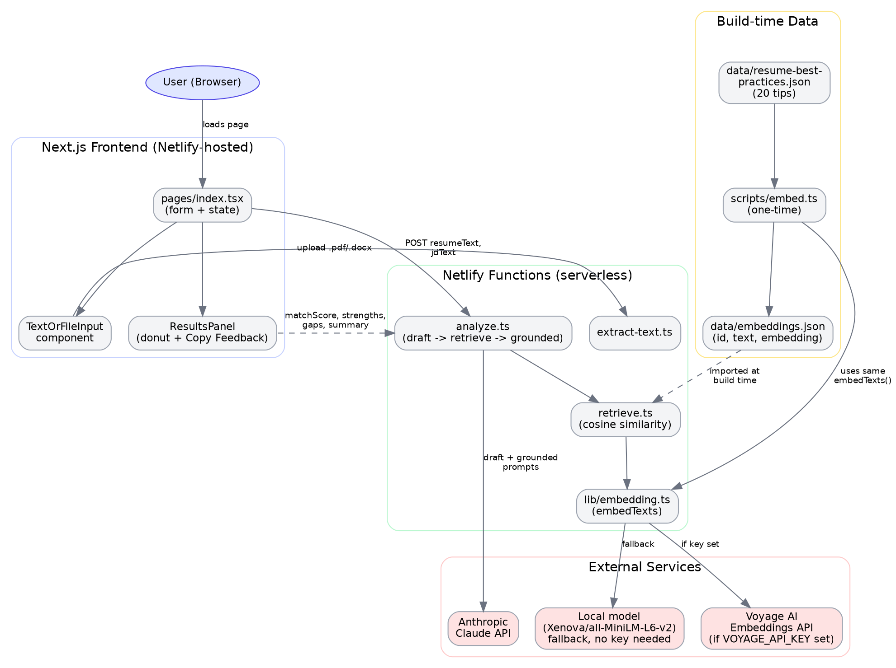
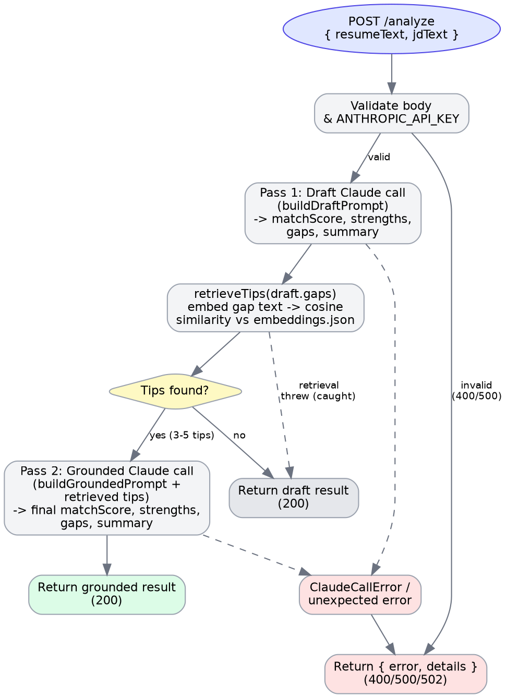

# AI Resume Analyzer

Paste a resume and a job description, get back a match score, strengths,
gaps, and a summary — generated by the Claude API.

## Architecture

The request flow makes two Claude calls: a draft pass, then a retrieval step
that pulls the 3–5 most relevant resume tips for that draft's gaps, then a
grounded pass that ties the final feedback to those tips.





- **Full write-up:** [`docs/design-doc.md`](docs/design-doc.md) (source) /
  [`docs/resume-analyzer-design-doc.pdf`](docs/resume-analyzer-design-doc.pdf)
  (rendered) — the complete HLD/LLD: component responsibilities, API
  contracts, data models, sequence flows, error-handling matrix, and known
  limitations.
- **Diagram sources:** [`docs/diagrams/architecture.dot`](docs/diagrams/architecture.dot)
  and [`docs/diagrams/analyze-flow.dot`](docs/diagrams/analyze-flow.dot)
  (Graphviz) — edit these and re-render with:
  ```bash
  dot -Tpng -Gdpi=150 docs/diagrams/architecture.dot -o docs/diagrams/architecture.png
  dot -Tpng -Gdpi=150 docs/diagrams/analyze-flow.dot -o docs/diagrams/analyze-flow.png
  ```

## Structure

- `pages/index.tsx` — the form page. Both the resume and job description fields
  have a "Paste text" / "Upload file" toggle; uploading a `.pdf` or `.docx`
  sends it to `extract-text` and fills the field with the extracted text
  (editable afterwards).
- `netlify/functions/analyze.ts` — takes `{ resumeText, jdText }`, calls the
  Claude API, and returns `{ matchScore, strengths, gaps, summary }`
- `netlify/functions/extract-text.ts` — takes `{ fileBase64, mimeType, fileName }`,
  parses a PDF (`pdf-parse`) or DOCX (`mammoth`), and returns `{ text }`
- `components/ScoreDonut.tsx` — recharts donut chart for the match score (0–100)
- `components/ResultsPanel.tsx` — the results card (donut + Strengths / Areas to
  Improve lists + summary), styled with Tailwind
- `components/LoadingState.tsx` — spinner shown while the analyze call is in flight
- `docs/` — full HLD/LLD design doc (markdown source + rendered PDF) and the
  Graphviz diagram sources/renders referenced above
- `.env.example` — copy to `.env` and add your key locally

## Setup

```bash
npm install
cp .env.example .env
# edit .env and add your ANTHROPIC_API_KEY
```

## Run locally

The form page needs the Netlify function running alongside it, so use the
Netlify CLI rather than `next dev` alone:

```bash
npm install -g netlify-cli   # one-time
netlify dev
```

This serves the Next.js app and makes `/.netlify/functions/analyze` available
at the same time.

## Deploy to Netlify (CLI)

Run these from inside the `ai-resume-analyzer` folder, in order:

```bash
npm install -g netlify-cli   # one-time, if you don't already have it
npm install                  # installs @netlify/plugin-nextjs, recharts, etc.

netlify login                # opens a browser to authenticate

# First time only — creates a new site or links to an existing one
netlify init
# or, to link an already-created site:
netlify link

# Set the API key as a real Netlify environment variable (not in .env,
# not committed to git). --context production scopes it to production
# deploys; drop that flag to also apply it to deploy previews/branches.
netlify env:set ANTHROPIC_API_KEY "your-real-key-here" --context production

# Ship it
netlify deploy --prod
```

`netlify deploy --prod` prints your live URL when it finishes (also visible
any time via `netlify open:site`).

### Verify it actually works in production

Since a deploy can succeed while the app itself is still broken (missing env
var, wrong function path, stale embeddings, etc.), check these on the live
URL before calling it done. I can't run these commands, click through the
UI, or view your live URL myself — this sandbox has no network route to
netlify.com/app, and I don't have your Netlify login or your real API keys —
so please run this checklist yourself and paste back any error output if
something doesn't work; I can debug from that.

1. **Site loads** — open the printed URL, confirm the form renders correctly
   on both desktop and a narrow (phone-width) viewport: the paste/upload
   toggle wraps sensibly, the Analyze button is full-width and easy to tap,
   nothing overflows horizontally.
2. **File upload works** — switch a field to "Upload file", upload a real
   `.pdf` or `.docx`, confirm the extracted text fills the textarea. Also
   try a `.txt` or other unsupported file — you should get a clear inline
   error, not a stuck spinner. If it fails, `netlify functions:log
   extract-text` shows the error.
3. **The full RAG-grounded flow works, not just a bare Claude call** — fill
   both fields and submit:
   - You should briefly see the loading spinner, then the results panel —
     donut chart, Strengths, Areas to Improve, and a Summary that's clearly
     about your actual resume/JD content.
   - The **grounding is working** if the `gaps` bullets and summary read as
     referencing specific, concrete practices (e.g. "quantify your impact
     with metrics") rather than generic filler — that's the retrieved-tips
     step doing its job. If feedback looks generic, check
     `netlify functions:log analyze` for a "Tip retrieval failed" warning
     (usually means `data/embeddings.json` wasn't committed, or wasn't
     regenerated after a Voyage/local-model switch).
   - Click **Copy Feedback** and paste it somewhere (a text editor, chat box)
     to confirm the clipboard actually has the full score/strengths/gaps/
     summary text.
4. **Error states behave** — temporarily submit with only one field filled
   (should show the inline "please provide both" message, no request sent);
   if you want to test the analyze failure path, temporarily set
   `ANTHROPIC_API_KEY` to a bad value in Netlify, redeploy, confirm you get
   a clear error message instead of a stuck spinner — then restore the real
   key and redeploy again.

`netlify env:list` confirms which env vars are actually set on the site if
anything above points at a missing/wrong key.

## Resume tips + embeddings (one-time)

- `data/resume-best-practices.json` — 20 short tips as `{ id, text }`.
- `scripts/embed.ts` — generates an embedding for each tip and writes
  `data/embeddings.json` as `{ id, text, embedding }`.

Run it once with:

```bash
npm install
npm run embed
```

By default (no `VOYAGE_API_KEY` set) it uses a local model
(`Xenova/all-MiniLM-L6-v2`, downloaded once and cached, no API key or
network cost after that). If you add `VOYAGE_API_KEY` to `.env`, it uses
Voyage AI's hosted embeddings instead (`voyage-3-lite`, well within the
free tier for 20 short strings) and falls back to the local model
automatically if that request fails for any reason.

Note the two paths produce embeddings of different dimensionality/space —
don't mix embeddings from a Voyage run with embeddings from a local-model
run in the same similarity search.

## How analyze.ts uses retrieval (retrieve.ts)

`analyze.ts` now makes up to two Claude calls per request:

1. **Draft pass** — the same prompt as before, producing a draft
   `{ matchScore, strengths, gaps, summary }`.
2. **Retrieval** — `retrieve.ts` embeds the draft's `gaps` (combined into
   one string, via the same `embedTexts()` helper `embed.ts` uses) and
   returns the 3-5 tips from `data/embeddings.json` most similar to it by
   cosine similarity.
3. **Grounded pass** — a second Claude call, same resume/JD, plus the
   retrieved tips listed as context, instructing Claude to explicitly tie
   `gaps` and `summary` to those specific tips rather than giving generic
   advice.

If retrieval fails for any reason (e.g. `data/embeddings.json` wasn't
committed, or the embedding call errors), `analyze.ts` falls back to
returning the draft result rather than failing the request — you'll just
get ungrounded feedback for that call.

**Two important deployment notes:**

- `retrieve.ts` imports `data/embeddings.json` directly (`import ... from
  "../../data/embeddings.json"`) so it gets bundled into the function at
  build time. A placeholder `data/embeddings.json` (`[]`) ships in the repo
  so the build always resolves — but until you run `npm run embed` and
  commit the real output, `retrieve.ts` has nothing to score against and
  every request silently falls back to the ungrounded draft.
  - **If your build fails with `Could not resolve "../../data/embeddings.json"`**,
    the file is missing entirely (not just empty) — usually because
    `data/` is `.gitignore`d, or the placeholder above got deleted rather
    than overwritten. Run `npm run embed` (see below) to (re)generate it,
    confirm `git status` shows it as a tracked file, commit, and redeploy.
- **Set `VOYAGE_API_KEY` in production.** Without it, both `embed.ts` and
  `retrieve.ts`'s fallback path load `@xenova/transformers` and download
  model weights at runtime. Inside a serverless function that's slow
  (multi-second cold starts, no persistent disk to cache the download
  between invocations) and risks pushing the function past Netlify's
  bundle-size limits. The Voyage path is a single small HTTP call and
  avoids all of this — the local model is really meant for local dev and
  the one-time `npm run embed`, not for the live `analyze` function.

## Notes / next steps

- Scanned/image-based PDFs have no extractable text layer, so `pdf-parse`
  will return an error for those — pasting the text is the fallback.
- See `docs/design-doc.md` §6 ("Known Limitations & Future Enhancements")
  for the fuller list — no automated tests, no rate limiting, no persisted
  history, etc.
