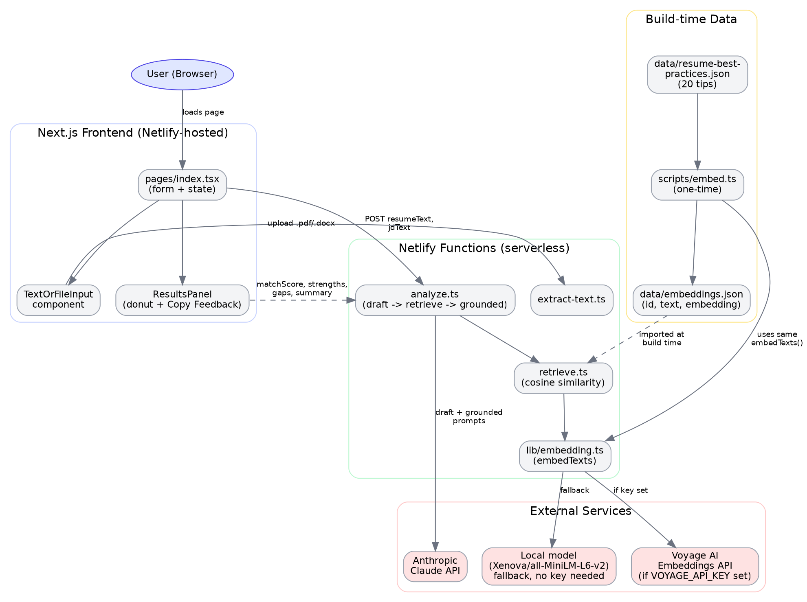
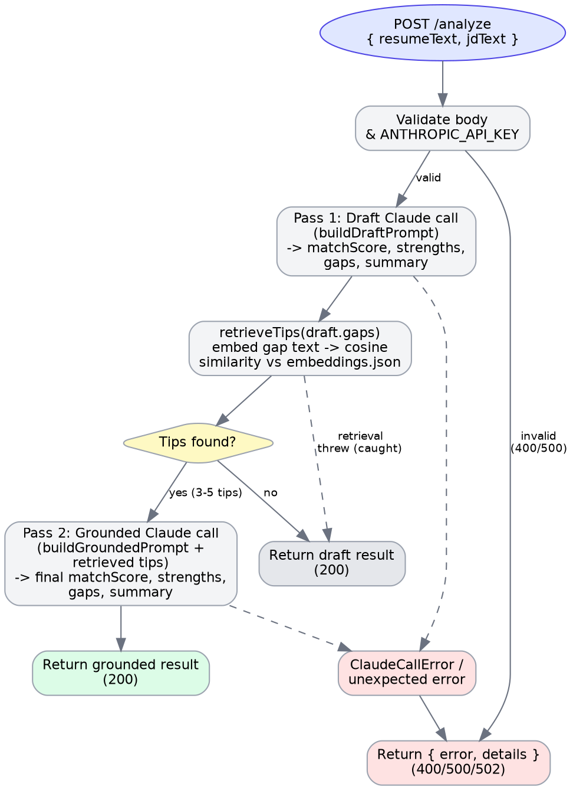

# 1. Introduction

## 1.1 Purpose

This document describes the architecture and detailed design of the **AI Resume Analyzer**, a web application that scores a resume against a job description and returns targeted, evidence-grounded improvement feedback. It is intended as a reference for anyone extending, deploying, or reviewing the system.

## 1.2 Scope

Covers the Next.js frontend, the Netlify serverless functions, the retrieval-augmented (RAG) grounding layer built on top of the Claude API, the one-time embedding pipeline, and the deployment model on Netlify.

## 1.3 Goals

- Let a user paste or upload (PDF/DOCX) a resume and a job description.
- Return a 0–100 match score, strengths, gaps, and a summary.
- Ground the gaps/summary in a small curated set of resume best-practice tips, retrieved by semantic similarity rather than hard-coded rules.
- Run entirely on Netlify's free/hobby tier (static hosting + serverless functions), with no dedicated backend server or database.

## 1.4 Non-Goals

- User accounts, authentication, or saved history (the app is stateless — no resume/JD text is persisted anywhere).
- Multi-language resume support.
- Real-time collaborative editing.

---

# 2. High-Level Design (HLD)

## 2.1 System Overview

The system is a **JAMstack application**: a statically-served Next.js frontend calls a small set of Netlify Functions, which in turn call two external AI providers (Anthropic's Claude for analysis, Voyage AI or a local model for embeddings). There is no traditional application server or database — the only persistent "data layer" is a small JSON file of resume tips and their pre-computed embeddings, generated once and committed to the repo.

## 2.2 Architecture Diagram



## 2.3 Major Components

| Component | Technology | Responsibility |
|---|---|---|
| Frontend | Next.js 14 (Pages Router), React, TypeScript, Tailwind CSS | Form UI, file upload, results display, clipboard export |
| `extract-text` function | Netlify Function, `pdf-parse`, `mammoth` | Converts an uploaded PDF/DOCX into plain text |
| `analyze` function | Netlify Function | Orchestrates the two-pass (draft → retrieve → grounded) Claude analysis |
| `retrieve` module | Plain TS module (bundled into `analyze`) | Embeds the draft's gaps and finds the most relevant tips by cosine similarity |
| `lib/embedding` module | Plain TS module | Single source of truth for "how to embed text" — Voyage AI or local model |
| Tips dataset | `data/resume-best-practices.json` | 20 curated `{ id, text }` resume best-practice tips |
| Embeddings dataset | `data/embeddings.json` | Pre-computed `{ id, text, embedding }` for each tip, generated by `scripts/embed.ts` |
| Anthropic Claude API | External | Generates the match score, strengths, gaps, and summary |
| Voyage AI API | External (optional) | Hosted text-embedding model, used when `VOYAGE_API_KEY` is set |
| Local embedding model | `@xenova/transformers`, `Xenova/all-MiniLM-L6-v2` | Offline fallback embedding model, no API key required |

## 2.4 Data Flow (Analyze Request)



At a high level, submitting the form triggers:

1. **Draft pass** — Claude scores the resume against the JD and returns a first-draft `{ matchScore, strengths, gaps, summary }`.
2. **Retrieval** — the draft's `gaps` are combined into one string, embedded, and compared (cosine similarity) against the 20 pre-embedded tips; the top 3–5 are kept.
3. **Grounded pass** — Claude is called again with the same resume/JD plus the retrieved tips as context, and instructed to explicitly reference those tips in the final `gaps` and `summary`.
4. If retrieval finds nothing (or fails), the system falls back to returning the draft result rather than failing the request.

## 2.5 Technology Stack

| Layer | Choice |
|---|---|
| Frontend framework | Next.js 14 (Pages Router) |
| Language | TypeScript throughout |
| Styling | Tailwind CSS (results/loading UI) + plain CSS (form UI) |
| Charts | Recharts (donut score chart) |
| Hosting | Netlify (static site + Functions), `@netlify/plugin-nextjs` |
| Serverless runtime | Netlify Functions, Node.js, esbuild bundler |
| LLM | Anthropic Claude (`claude-sonnet-4-5`) |
| Embeddings | Voyage AI (`voyage-3-lite`) or local `Xenova/all-MiniLM-L6-v2` |
| File parsing | `pdf-parse` (PDF), `mammoth` (DOCX) |
| Tooling | `tsx` (run the one-time embed script) |

## 2.6 Deployment Architecture

- The Next.js app is built (`next build`) and deployed via the official `@netlify/plugin-nextjs`, which manages SSR/static output automatically — `netlify.toml` deliberately does **not** set `publish` manually, to avoid conflicting with the plugin.
- Custom Netlify Functions live under `netlify/functions/` (`analyze.ts`, `extract-text.ts`, plus the internal `retrieve.ts` module bundled into `analyze`).
- `data/embeddings.json` is imported directly by `retrieve.ts` (`import ... from "../../data/embeddings.json"`), so it is baked into the function bundle at **build time** — it must be generated (`npm run embed`) and committed before deploying; it is not read from disk at request time.
- Secrets (`ANTHROPIC_API_KEY`, optionally `VOYAGE_API_KEY`) are set as Netlify environment variables, never committed to the repo (`.env.example` documents them; `.env` is git-ignored).

## 2.7 Non-Functional Requirements

| Concern | Approach |
|---|---|
| **Latency** | The grounded flow makes two sequential Claude calls per request (draft + grounded), roughly doubling latency and token cost versus a single call. This is a deliberate trade-off for grounded, specific feedback. |
| **Availability / graceful degradation** | Retrieval failures (missing embeddings, embedding API errors) fall back to the ungrounded draft result rather than a hard failure. Voyage API failures fall back to the local model. |
| **Scalability** | Stateless serverless functions scale horizontally with Netlify's platform; no shared mutable state between requests. |
| **Security** | API keys live only in Netlify environment variables. No resume/JD text is persisted server-side. Client-side file parsing is not used for PDFs/DOCX (parsed server-side to avoid shipping heavy parser libraries to the browser). |
| **Cost control** | Embeddings default to a free local model unless `VOYAGE_API_KEY` is explicitly set; the local model is discouraged in production specifically because of serverless cold-start cost (see §6). |
| **Portability** | No database — the entire "state" of the tips/embeddings system is two JSON files, easy to inspect, diff, and regenerate. |

---

# 3. Low-Level Design (LLD)

## 3.1 Module Breakdown

| Path | Type | Responsibility |
|---|---|---|
| `pages/index.tsx` | React page | Form state, submit handling, renders `TextOrFileInput`, `LoadingState`, `ResultsPanel` |
| `pages/_app.tsx` | React app wrapper | Imports global styles |
| `components/ScoreDonut.tsx` | React component | Recharts donut chart for `matchScore` |
| `components/ResultsPanel.tsx` | React component | Renders score/strengths/gaps/summary, "Copy Feedback" button |
| `components/LoadingState.tsx` | React component | Spinner shown while `analyze` is in flight |
| `netlify/functions/extract-text.ts` | Netlify Function | PDF/DOCX → plain text |
| `netlify/functions/analyze.ts` | Netlify Function | Draft → retrieve → grounded orchestration; Claude API calls |
| `netlify/functions/retrieve.ts` | TS module (no HTTP endpoint) | Embeds gap text, cosine-similarity search over `embeddings.json` |
| `lib/embedding.ts` | TS module | `embedTexts()` — Voyage AI or local model, shared by `embed.ts` and `retrieve.ts` |
| `scripts/embed.ts` | One-time Node script | Generates `data/embeddings.json` from `data/resume-best-practices.json` |
| `data/resume-best-practices.json` | Static data | 20 `{ id, text }` tips |
| `data/embeddings.json` | Generated data | 20 `{ id, text, embedding }` records |

## 3.2 Frontend Design

### 3.2.1 `pages/index.tsx` — top-level state

```ts
resumeText: string
jdText: string
loading: boolean
error: string | null
result: AnalyzeResult | null
```

`handleSubmit`:

1. Prevent default, clear `error`/`result`.
2. If either text field is empty (after `.trim()`), set a client-side validation error and return (no network call).
3. Set `loading = true`, `POST /.netlify/functions/analyze` with `{ resumeText, jdText }`.
4. Parse the response defensively (`safeJson`, tolerates a non-JSON body).
5. On non-2xx, throw with the server's `error` message (or a generic one with the status code).
6. On success, `setResult(data)`. Always `setLoading(false)` in `finally`.

### 3.2.2 `TextOrFileInput` component — local state machine

```ts
mode: "paste" | "upload"
fileName: string | null
extracting: boolean
extractError: string | null
```

State transitions:

- `switchMode()` — toggles `mode`, clears `extractError`.
- File selected → validate extension client-side (`.pdf`/`.docx`) → `extracting = true`, clear the field's text → `POST /.netlify/functions/extract-text` with the file as base64 → on success, `onChange(text)`; on failure, `extractError` is set and the field's text stays empty.
- Both the paste textarea and the post-extraction textarea write through the same `onChange` callback, so a user can edit extracted text before submitting.
- The whole component accepts a `disabled` prop (driven by the parent's `loading` state) so fields can't be edited mid-analysis.

### 3.2.3 `ResultsPanel` — Copy Feedback

`buildFeedbackText(result)` renders the result as plain text:

```
Match Score: {n}/100

Strengths:
- ...

Areas to Improve:
- ...

Summary:
{summary}
```

`copyToClipboard(text)` tries `navigator.clipboard.writeText` (secure-context only), and falls back to a hidden `<textarea>` + `document.execCommand("copy")` for non-secure contexts or older browsers. Button label cycles `"Copy Feedback" → "Copied!" / "Couldn't copy" → back to "Copy Feedback"` after 2 seconds.

## 3.3 Backend Design

### 3.3.1 `extract-text.ts`

**Request:**
```ts
{ fileBase64: string; mimeType?: string; fileName?: string }
```

**Logic:**

1. Reject non-POST methods (405) and malformed JSON (400).
2. Determine file type from `mimeType` or filename extension.
3. `.pdf` → `pdf-parse`; `.docx` → `mammoth.extractRawText`; anything else → 400.
4. Empty extracted text (e.g. a scanned/image-only PDF) → 422 with a message suggesting the user paste text instead.

**Response (200):** `{ text: string }`

### 3.3.2 `lib/embedding.ts` — `embedTexts(texts, inputType)`

```
if VOYAGE_API_KEY is set:
    try: call Voyage AI (POST /v1/embeddings, model = voyage-3-lite)
         sort results by `index` (Voyage does not guarantee order)
         return { embeddings, source: "voyage:voyage-3-lite" }
    catch: log a warning, fall through
use local model (Xenova/all-MiniLM-L6-v2):
    lazily load + cache the pipeline (once per warm process)
    mean-pool + normalize each text's embedding
    return { embeddings, source: "local:Xenova/all-MiniLM-L6-v2" }
```

`inputType` (`"document"` for the tips, `"query"` for a search query) is passed through to Voyage, which optimizes the embedding differently for each role; the local model ignores it.

### 3.3.3 `retrieve.ts` — `retrieveTips(gaps, topK)`

1. Combine `gaps` into one string (`gaps.join(". ")`, empty entries filtered out).
2. If the combined string or the tips list is empty, return `[]` immediately.
3. Embed the combined string via `embedTexts([text], "query")`.
4. For each of the 20 tips (imported directly from `data/embeddings.json`), compute cosine similarity between the query embedding and the tip's embedding:

```
cosine(a, b) = dot(a, b) / (‖a‖ · ‖b‖)
```

5. Sort descending by score, return the top `topK` (clamped to the 3–5 range regardless of the caller's request).
6. Throws if the query and tip embeddings have mismatched dimensionality (a signal that the tips were embedded with a different model/source than the current query — see §6).

### 3.3.4 `analyze.ts` — orchestration

```ts
interface AnalyzeRequestBody { resumeText?: string; jdText?: string }
interface AnalyzeResult {
  matchScore: number;   // 0-100, clamped and rounded
  strengths: string[];
  gaps: string[];
  summary: string;
}
```

**`callClaude(prompt, apiKey)`** (shared by both passes):

1. `POST https://api.anthropic.com/v1/messages` with `model = claude-sonnet-4-5-20250929`, `max_tokens = 1500`.
2. Non-2xx → throws `ClaudeCallError(502)`.
3. Extract the first `text` content block; missing/non-string → `ClaudeCallError(502)`.
4. Strip a stray ```` ```json ... ``` ```` fence if present, `JSON.parse` the remainder; parse failure → `ClaudeCallError(502)`.
5. Validate the shape (`matchScore` is a number; `strengths`/`gaps` are string arrays; `summary` is a string) — invalid shape → `ClaudeCallError(502)`.
6. Clamp `matchScore` to `[0, 100]` and round it.

**Handler flow:**

1. Reject non-POST (405), missing `ANTHROPIC_API_KEY` (500), malformed JSON body (400), or missing/empty `resumeText`/`jdText` (400).
2. **Pass 1:** `callClaude(buildDraftPrompt(resumeText, jdText))` → `draft`.
3. **Retrieval:** `retrieveTips(draft.gaps, 4)`, wrapped in try/catch — a thrown error is logged and treated as "no tips found," not a request failure.
4. If no tips were retrieved, return `draft` (200) directly.
5. **Pass 2:** `callClaude(buildGroundedPrompt(resumeText, jdText, retrievedTips))` → `grounded`; return it (200).
6. Any `ClaudeCallError` is returned with its own status code and `details`; any other exception returns 500 with a generic message.

### 3.3.5 Prompt Design

- **Draft prompt** asks for strict JSON only (no markdown fences, no preamble), with the four required fields, phrased to keep `gaps`/`summary` constructive rather than harsh.
- **Grounded prompt** additionally lists the 3–5 retrieved tips (`"1. <tip text>"` per line) and explicitly instructs Claude to reference the underlying practice — in its own words, not verbatim — inside `gaps` and `summary`, tied to what it actually found in the resume rather than generic advice.

## 3.4 API Contracts

| Endpoint | Method | Request Body | Success Response | Error Responses |
|---|---|---|---|---|
| `/.netlify/functions/extract-text` | POST | `{ fileBase64, mimeType?, fileName? }` | `200 { text }` | `400` bad input/unsupported type, `422` no extractable text, `500` parse failure |
| `/.netlify/functions/analyze` | POST | `{ resumeText, jdText }` | `200 { matchScore, strengths, gaps, summary }` | `400` bad input, `405` wrong method, `500` missing key / unexpected error, `502` Claude call failed or returned an unexpected shape |

## 3.5 Data Models

```ts
// Tip source data (data/resume-best-practices.json)
interface Tip { id: string; text: string }

// Pre-computed embeddings (data/embeddings.json)
interface EmbeddedTip extends Tip { embedding: number[] }

// Output of retrieve.ts
interface RetrievedTip { id: string; text: string; score: number }

// Output of analyze.ts (both passes)
interface AnalyzeResult {
  matchScore: number;
  strengths: string[];
  gaps: string[];
  summary: string;
}
```

## 3.6 Sequence: File Upload & Extraction

1. User switches a field to "Upload file" and selects a `.pdf`/`.docx`.
2. Client validates the extension; on failure, shows an inline error immediately (no network call).
3. Client reads the file as base64 (`FileReader.readAsDataURL`, stripping the data-URL prefix).
4. Client `POST`s `{ fileBase64, mimeType, fileName }` to `extract-text`.
5. Function decodes the base64 to a `Buffer`, routes to `pdf-parse` or `mammoth` by type.
6. Extracted, trimmed text is returned; empty text → `422`.
7. Client fills the field's textarea with the returned text (still editable) or shows the error inline.

## 3.7 Sequence: RAG-Grounded Analyze

See §2.4 / the analyze-flow diagram. In sequence-diagram terms:

```
Client -> analyze: POST { resumeText, jdText }
analyze -> Claude: draft prompt
Claude --> analyze: draft { matchScore, strengths, gaps, summary }
analyze -> retrieve: retrieveTips(draft.gaps, 4)
retrieve -> embedding: embedTexts([gapText], "query")
embedding -> Voyage/Local: embed
Voyage/Local --> embedding: vector
embedding --> retrieve: vector
retrieve -> retrieve: cosine similarity vs 20 tips
retrieve --> analyze: top 3-5 RetrievedTip[]
alt tips found
  analyze -> Claude: grounded prompt (+ tips)
  Claude --> analyze: grounded result
  analyze --> Client: 200 grounded result
else no tips
  analyze --> Client: 200 draft result
end
```

## 3.8 Error Handling Matrix

| Status | Origin | Meaning | Frontend behavior |
|---|---|---|---|
| 400 | `extract-text` / `analyze` | Missing/invalid request body or empty fields | Inline error message under the relevant field/form |
| 405 | `analyze` | Wrong HTTP method (defensive; UI never triggers this) | N/A |
| 422 | `extract-text` | File parsed but contained no extractable text (e.g. scanned PDF) | Inline error suggesting pasting text instead |
| 500 | either function | Missing `ANTHROPIC_API_KEY`, or an unexpected server-side exception | Generic error banner |
| 502 | `analyze` | Claude API call failed, or its response didn't parse/validate as expected JSON | Generic error banner (with `details` available in function logs) |
| *(silent fallback)* | `analyze` | Tip retrieval threw or found nothing | No error surfaced — draft (ungrounded) result is returned instead |

---

# 4. Data Design

## 4.1 `data/resume-best-practices.json`

An array of 20 objects, each `{ id: "tip-01".."tip-20", text: "<short, concrete tip>" }`, covering ATS parsing, quantified impact, formatting, structure, and proofreading.

## 4.2 `data/embeddings.json`

Generated (not hand-written) by `scripts/embed.ts`. Same 20 records, each extended with an `embedding: number[]` field. Dimensionality depends on which model produced it (Voyage's `voyage-3-lite` vs. the local `all-MiniLM-L6-v2` model) — the two are **not interchangeable**; regenerating with a different source requires re-running `npm run embed` in full, not merging.

## 4.3 Embedding Model Selection

Both the one-time tip-embedding step and the runtime query-embedding step call the same `embedTexts()` function, so they can't silently drift onto different models. Selection is purely environment-driven: presence of `VOYAGE_API_KEY` selects Voyage AI; its absence, or a runtime failure, selects the local model.

---

# 5. Security Considerations

- **Secrets**: `ANTHROPIC_API_KEY` and `VOYAGE_API_KEY` live only in Netlify's environment variable store; `.env` is git-ignored and `.env.example` never contains a real key.
- **No persistence of user content**: resume and job description text exist only for the duration of a single request; nothing is written to disk or a database.
- **Server-side file parsing**: PDF/DOCX parsing happens in the `extract-text` function, not the browser, keeping heavy parser dependencies out of the client bundle and avoiding exposure of parsing internals.
- **Input validation**: both functions reject non-POST methods, malformed JSON, and empty/missing required fields before doing any external API work.
- **Third-party data**: text extracted from an uploaded file, and gap text derived from Claude's own output, are the only "untrusted" inputs fed back into prompts — both are treated as data (interpolated into a fixed prompt template), never as instructions to follow.

---

# 6. Known Limitations & Future Enhancements

| Limitation | Detail | Possible Enhancement |
|---|---|---|
| Two Claude calls per request | Doubles latency and token cost versus a single-pass design | Consider a single call that self-retrieves via tool use, or cache draft gaps for repeat submissions |
| Local embedding model in production | If `VOYAGE_API_KEY` is unset (or Voyage fails) in the live `analyze` function, `@xenova/transformers` downloads model weights at runtime with no persistent cache between cold starts — slow, and risks Netlify's function size limits | Always set `VOYAGE_API_KEY` in production; reserve the local model for local dev and the one-time `npm run embed` |
| Scanned/image-only PDFs | `pdf-parse` extracts nothing from a PDF with no text layer | Add OCR (e.g. `pytesseract`) as a further fallback |
| No automated tests | Current implementation has no unit/integration test suite | Add tests for `retrieveTips` (cosine similarity correctness) and the `analyze` fallback path |
| No rate limiting | Nothing currently prevents repeated/abusive calls to `analyze` (each call costs Claude API tokens) | Add basic rate limiting (e.g. Netlify Edge Middleware or a simple IP-based limiter) |
| No persisted history | Users can't revisit past analyses | Optional: add auth + a database if this becomes a requirement |

---

# 7. Appendix

## 7.1 Environment Variables

| Variable | Required | Used by | Purpose |
|---|---|---|---|
| `ANTHROPIC_API_KEY` | Yes | `analyze.ts` | Authenticates calls to the Claude API |
| `VOYAGE_API_KEY` | No | `embed.ts`, `retrieve.ts` (via `lib/embedding.ts`) | Enables Voyage AI embeddings; falls back to a local model if unset |

## 7.2 Repository Structure

```
ai-resume-analyzer/
├── data/
│   ├── resume-best-practices.json
│   └── embeddings.json            (generated — run `npm run embed`)
├── lib/
│   └── embedding.ts
├── scripts/
│   └── embed.ts
├── netlify/functions/
│   ├── analyze.ts
│   ├── extract-text.ts
│   └── retrieve.ts
├── components/
│   ├── ScoreDonut.tsx
│   ├── ResultsPanel.tsx
│   └── LoadingState.tsx
├── pages/
│   ├── _app.tsx
│   └── index.tsx
├── styles/globals.css
├── netlify.toml
├── package.json
└── README.md
```
